  

  
  
  
  
  
  

---

## 🦆 UEFN-Ducky

> [**UEFN-Ducky**](https://github.com/Lezzy09/UEFN-Ducky): an AI-powered companion for Unreal Editor for Fortnite. Every plugin below installs from its Store.

## 🧠 LLM gateways

Plug any model into Ducky's **Settings → LLMs**.

<table>
  <tr>
    <td width="50%" valign="top">
      <h4><a href="https://github.com/Lezzy09/uefn-plugin-anthropic">Anthropic</a></h4>
      
Anthropic API key + <b>Claude Code</b> coding agent.

    </td>
    <td width="50%" valign="top">
      <h4><a href="https://github.com/Lezzy09/uefn-plugin-openai">OpenAI</a></h4>
      
OpenAI API key + <b>Codex</b> coding agent.

    </td>
  </tr>
  <tr>
    <td valign="top">
      <h4><a href="https://github.com/Lezzy09/uefn-plugin-google">Google</a></h4>
      
Gemini API key + <b>Gemini CLI</b> coding agent.

    </td>
    <td valign="top">
      <h4><a href="https://github.com/Lezzy09/uefn-plugin-spacexai">SpaceXAI</a></h4>
      
Grok API key + <b>Grok Build</b> coding agent.

    </td>
  </tr>
  <tr>
    <td valign="top">
      <h4><a href="https://github.com/Lezzy09/uefn-plugin-kimi">Kimi</a></h4>
      
Moonshot Open Platform API.

    </td>
    <td valign="top">
      <h4><a href="https://github.com/Lezzy09/uefn-plugin-ollama">Ollama</a></h4>
      
Run local models through your own Ollama server.

    </td>
  </tr>
</table>

## 🛠️ Creator tools

<table>
  <tr>
    <td width="50%" valign="top">
      <h4><a href="https://github.com/Lezzy09/uefn-plugin-verse">Verse</a></h4>
      
Verse digests, device wiring, compile errors, UMG Widget Blueprint tools and starter packs (Player Core, Economy, Tycoon…).

    </td>
    <td width="50%" valign="top">
      <h4><a href="https://github.com/Lezzy09/uefn-plugin-animation">Animation</a></h4>
      
IK retargeting, skeleton sockets, Level Sequence and AnimSequence authoring.

    </td>
  </tr>
  <tr>
    <td valign="top">
      <h4><a href="https://github.com/Lezzy09/uefn-plugin-uasset-preview">UAsset Preview</a></h4>
      
Preview <code>.uasset</code>, <code>.umap</code>, <code>.fbx</code> and <code>.glb</code> files (thumbnails, materials, 3D meshes) right in the panel.

    </td>
    <td valign="top">
      <h4><a href="https://github.com/Lezzy09/uefn-plugin-adobe">Adobe</a></h4>
      
Drive <b>Illustrator</b> and <b>Photoshop</b> from the Ducky MCP through Windows COM.

    </td>
  </tr>
  <tr>
    <td valign="top" colspan="2">
      <h4><a href="https://github.com/Lezzy09/uefn-plugin-discord">Discord</a></h4>
      
Discord bot chat, <code>!ducky</code> commands and server-admin tools for the agent.

    </td>
  </tr>
</table>
